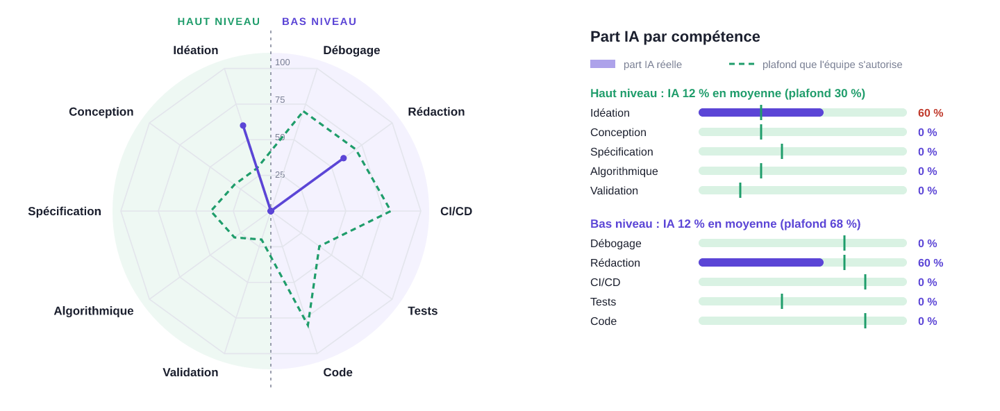

<!--
MODE D'EMPLOI (ces commentaires n'apparaissent pas dans le PDF)
- Structure calquée sur l'exemple de l'enseignant : sections 01 à 07, puis l'annexe.
  Les sections 08 et suivantes de l'exemple (livraison, fiches des features)
  arriveront à la v0.1.0.
- Chacun ne modifie QUE sa section, depuis SON compte, via une pull request.
- Les consignes sous chaque titre sont des questions : répondez-y avec vos mots,
  puis supprimez le commentaire.
- Limite : 4 pages au total, annexe comprise. Budget de chaque section entre crochets.
- Pas d'emoji ni de flèche dans le texte : le moteur PDF par défaut les refuse.
-->

# 01 Équipe, comptes développeurs et dépôt

<!--
Responsable : ... [60 mots + le tableau]
- Le tableau : membre, compte GitHub, email des commits (git config user.email).
  Dépôt public : adresse noreply de GitHub, pas l'email personnel.
- Une phrase : chacun a vérifié que son email Git est associé à son compte GitHub.
- L'URL du dépôt unique (les quatre couches dans le même dépôt).
- L'organisation : qui porte quel domaine ; une feature complète par membre et par
  itération, de la BD au front ; les tâches transverses partagées ; chaque pull
  request relue par un autre membre.
-->

| Membre | Compte GitHub | Email des commits |
|---------|---------|--------------|
|  |  |  |
| Rafael RODRIGUES | @rdsrafa  | rafi.rodrigues10@gmail.com |
|  |  |  |
| Steven KAMEL | @Stevenkml | 43005976@parisnanterre.fr |

# 02 Projet et caractère innovant

## 1. Mise en contexte

Cluedo est un jeu de société d’enquête dans lequel les joueurs cherchent à découvrir qui a commis un crime dans le manoir Tudor, en déduisant la vérité à partir des indices disponibles.

Notre projet reprend ce principe à l’échelle de la faculté. Le jeu propose d’enquêter sur des situations inspirées de problématiques que nous avons rencontrées au cours de nos études.

L’année dernière, dans un cours de programmation orientée objet, un sujet d’examen a fuité, ce qui nous a obligés à repasser l’épreuve. Cet événement constitue un exemple de scénario que notre jeu pourrait proposer.

Les joueurs devront mener leur enquête en déterminant, à partir des indices, qui a pu accéder à certains lieux ou équipements : une salle, une imprimante ou encore un serveur. Le tout se déroule dans un environnement interactif, au sein d’un campus fictif.

## 2. Objectif et problématique

L’objectif du projet est de créer un jeu d’enquête interactif capable de générer automatiquement des scénarios cohérents, tout en permettant aux joueurs de progresser grâce aux indices et aux explications fournies.

**Problématique :**

> Comment générer automatiquement des enquêtes cohérentes, à solution unique et de difficulté maîtrisée, puis expliquer chaque déduction, dans des situations proches du quotidien d’un campus ?

## 3. Ce qui rend notre projet innovant

### 3.1. Une seule bonne réponse

Dans les énigmes conçues manuellement, il peut arriver que plusieurs coupables soient possibles, ou qu’aucune solution ne soit correcte.

Notre programme vérifie chaque enquête avant de la proposer au joueur. Il s’assure qu’elle possède exactement une solution et que les indices disponibles permettent de la retrouver.

### 3.2. Chaque déduction est expliquée

Lorsque le joueur se trompe ou rencontre une difficulté, le jeu ne se contente pas d’indiquer que sa réponse est fausse.

Il présente le raisonnement étape par étape et peut proposer un indice pour aider le joueur à progresser. Le jeu devient ainsi un outil permettant de développer ses capacités de déduction.

### 3.3. Un campus fictif, des incidents réalistes

L’histoire se déroule dans une faculté imaginaire peuplée de personnages inventés.

Les enquêtes s’inspirent de situations réalistes pouvant survenir dans un environnement universitaire, comme une fuite de sujet d’examen, une intrusion sur un serveur ou la disparition de matériel.

### 3.4. Une difficulté réglable

Le jeu doit pouvoir proposer des enquêtes de difficultés différentes.

Il peut notamment intégrer de fausses pistes, avec des suspects qui semblent coupables sans l’être. Cela rend les enquêtes plus réalistes et plus stimulantes, tout en conservant une solution unique.

# 03 Scénarios d'usage

<!--
Responsable : NATHAN. [180 mots : 6 scénarios de 30 mots]
- 5 ou 6 scénarios numérotés, au format de l'exemple :
  « En tant que <rôle>, je <action>. L'application <ce qu'elle calcule>, afin de <bénéfice>. »
- Chaque feature de la v0.1.0 a son scénario ; ajoutez une ou deux features de la v0.2.0.
- Chaque scénario montre ce que l'application CALCULE, pas ce qu'elle stocke.
- Au moins deux rôles différents.
- Mêmes noms de features que dans la section 04 ; aucun détail d'interface.
-->

# 04 Plan des features

<!--
Responsable : NATHAN pour le tableau ; chaque membre rédige lui-même ses 3 cases.
[1 phrase + le tableau ; 10 mots par case au plus]
- Règle de l'enseignant : « Une feature a un effet sur la BD, le back, l'API REST
  et le front. Chaque feature est portée par une seule personne et repose sur un
  algorithme identifié. »
- Test des 4 couches, pour chaque feature : quelle table, quel traitement,
  quel endpoint, quel écran ?
- Format d'une case : « Nom de la feature — algorithme ».
-->

| Version | Membre 1 (domaine) | Membre 2 (domaine) | Membre 3 (domaine) | Membre 4 (domaine) |
|------|-----------|-----------|-----------|-----------|
| v0.1.0 24/11 |  |  |  |  |
| v0.2.0 08/12 |  |  |  |  |
| v1.0.0 19/01 |  |  |  |  |

# 05 Architecture

<!--
Responsable : ... [120 mots + le tableau]
- Le tableau, une ligne par couche ; pour chaque choix, une raison.
- Pas de découpage « back d'abord, front ensuite » : chaque feature traverse
  les 4 couches dès la v0.1.0.
- Qualité et livraison : tests, couverture, qualité de code et intégration continue
  sont exigés à la v0.1.0, badges compris. Conteneurs : exigés à la v0.2.0.
- Où vivent les algorithmes : un module par domaine, cœur en Java pur,
  testable sans Spring ni BD.
- Le modèle commun : les données partagées par toutes les features (l'affaire ?),
  fixées dès maintenant pour que les 4 features avancent en parallèle.
- Schéma facultatif (l'exemple de l'enseignant n'en a pas) : seulement s'il tient
  dans les 4 pages. Image dans doc/img/, puis retirer les balises de commentaire
  autour de la ligne d'image sous le tableau.
-->

# Architecture technique et frameworks envisagés

Notre projet repose sur une **architecture trois tiers** :
un front-end, un back-end exposant une API REST et une
base de données relationnelle.

## Front-end – Angular

Angular permettra de développer l'interface interactive
de notre jeu d'enquête inspiré du Cluedo, situé dans un
campus universitaire fictif. Les joueurs pourront explorer
des scénarios, consulter des indices, interroger les
informations disponibles, formuler des hypothèses et
progresser dans leurs enquêtes.

## Back-end – Java avec Spring Boot

Le back-end constituera le **cœur algorithmique** de notre
application. Il assurera la génération automatique
d'enquêtes cohérentes, la vérification de leur solution
unique et la résolution par déduction logique.

Les algorithmes permettront également d'évaluer la
difficulté des enquêtes, de proposer des indices adaptés
et d'expliquer les raisonnements étape par étape.

Le système pourra aussi vérifier les enquêtes
personnalisées créées par les enseignants.

Une API REST assurera la communication avec Angular
via HTTP et JSON.

## Base de données – PostgreSQL

PostgreSQL stockera les scénarios d'enquête, les suspects,
les lieux, les indices, les solutions ainsi que les
informations relatives aux joueurs et à leur progression.

La communication avec Java pourra utiliser
**Spring Data JPA**.

## Organisation du développement

Nous développerons d'abord le back-end Java, notamment
les algorithmes de génération, de vérification et de
déduction, puis les API REST et le front-end Angular.

Cette séparation facilitera le développement collaboratif,
les tests des algorithmes et la maintenance de l'application.

## Schéma de l'architecture

| Couche | Choix | Remarques |
|------|--------------|--------------|
| Front |  |  |
| API REST |  |  |
| Back |  |  |
| BD |  |  |
| Qualité et livraison |  |  |
| Conteneurs |  |  |

<!-- {width=45%} -->

# 06 Démarche pour chaque feature

<!--
Responsable : ... [le tableau : 5 étapes, 15 mots par case au plus]
- Les étapes d'une feature, dans l'ordre, de l'idée au front, et pour chacune
  le critère qui dit qu'elle est terminée.
-->

| Étape | Ce qu'on fait | Terminé quand |
|-----|---------------|----------|
|  |  |  |

# 07 Protocole d'usage de l'IA

<!--
Responsable : ... [120 mots + le tableau : 6 lignes, 10 mots par case au plus]
- Le principe, en une phrase. Le livret : « le groupe doit garder la maîtrise de
  l'outil, de la qualité des livraisons logicielles, de l'explicabilité de la
  structure et du fonctionnement du code ».
- Le tableau : activité, ce que fait l'IA, ce que fait l'humain.
- Les interdits. Rappel du livret : IA interdite pendant les évaluations.
- La traçabilité : section « Usage de l'IA » de chaque pull request ; une araignée
  par livrable (annexe) ; éventuellement un dossier exemples-ia/ comme dans l'exemple.
- L'usage déjà fait, déclaré tel quel : choix du sujet, idées de features,
  structure de ce dossier, mise en place du dépôt, script de l'araignée.
-->
Principe :
L’intelligence artificielle est utilisée comme un assistant pour suggérer des solutions, expliquer des notions et relire le code. L’équipe reste responsable de ses choix techniques et de l’ensemble du code intégré au projet. Chaque membre doit être capable d’expliquer le code qu’il soumet, notamment lors de la soutenance.

| Activité | Ce que fait l'IA | Ce que fait l'humain |
|----------|------------------|----------------------|
| Idéation et conception | Aide à approfondir les idées et à proposer des pistes d'amélioration. | Imagine les fonctionnalités, définit les besoins et choisit les solutions à développer. |
| Algorithme (cœur de la feature) | Suggère des algorithmes et explique leur fonctionnement. | Choisit l'algorithme adapté, vérifie sa logique et comprend son fonctionnement. |
| Code technique (API, front, configuration) | Génère des exemples de code et propose des implémentations. | Adapte le code à l'architecture du projet, le vérifie et l'intègre. |
| Tests | Propose des cas de test et peut aider à analyser des résultats. | Exécute les tests, analyse les résultats et vérifie que la fonctionnalité répond aux besoins. |
| Documentation | Aide à rédiger les commentaires, les descriptions et la documentation technique. | Vérifie l'exactitude des informations et valide la documentation finale. |
| Débogage | Analyse les erreurs et suggère des corrections possibles. | Identifie la cause du problème, teste les corrections et valide la solution retenue. |

Règles et interdictions :
Le code généré par l’IA ne doit jamais être intégré sans vérification et sans compréhension de son fonctionnement. Il est interdit de considérer les réponses de l’IA comme systématiquement correctes ou de lui déléguer les décisions techniques finales. Les membres doivent également éviter de lui transmettre des secrets, des mots de passe ou des informations confidentielles.

Traçabilité :
Chaque pull request comporte une section « Usage de l’IA » précisant les tâches réalisées avec son aide et les vérifications effectuées par le développeur. Pour chaque livrable, une représentation en araignée de la répartition entre les contributions humaines et celles de l’IA est produite à partir des estimations de l’équipe.

Utilisation pour le présent dossier :
Pour la rédaction de cette section, l’IA a été utilisée comme aide à la formulation et à la structuration des idées. Le contenu final est relu et validé par le membre responsable.

# Annexe : part IA et part humaine du dossier de lancement

<!--
Responsable : ... [30 mots + le graphe]
1. Fixez en équipe doc/part-ia/plafonds.json : plafonds communs à tous les livrables,
   plus bas pour le haut niveau.
2. Estimez honnêtement doc/part-ia/dossier-lancement.json : ce dossier et la mise
   en place du dépôt.
3. Lancez : python doc/outils/araignee.py doc/part-ia/dossier-lancement.json
4. Retirez les balises de commentaire autour de la ligne d'image ci-dessous.
5. Une phrase de constat : sur quels axes la part IA dépasse-t-elle votre plafond, et pourquoi ?
-->

<!-- {width=75%} -->
